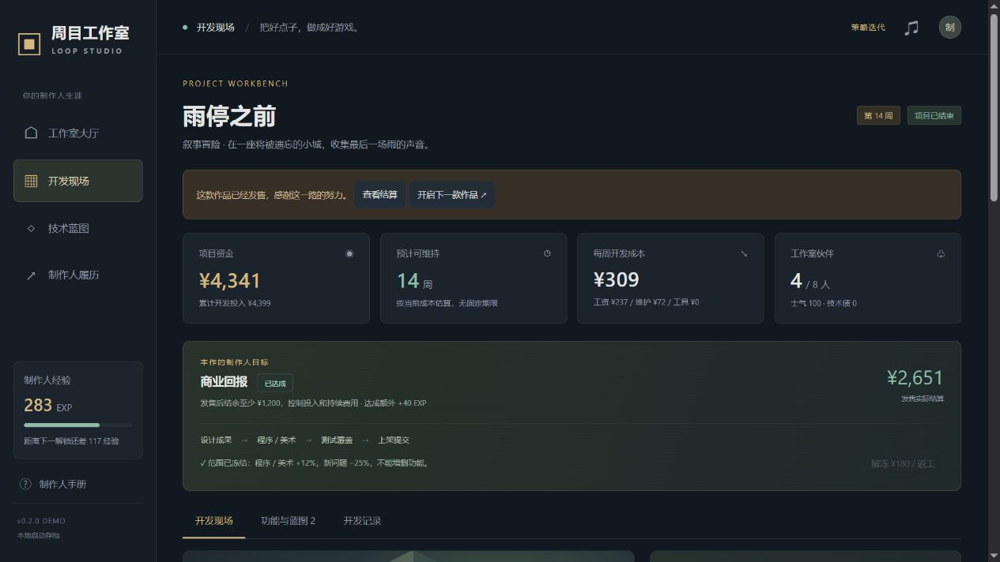

# 周目工作室 · 策略迭代 Demo v0.2.0

沿用「周目小镇 v3.17.0」的回合决策、种子随机、蓝图构筑、局外解锁、存档与原创合成音频框架。保留不设回合上限、无任务系统、每周一次事件，以及独立的资质准备和上架准备。

## 试玩

下载本仓库后，双击根目录的 `index.html` 即可离线试玩，无需安装或联网。也可打开 `dist/index.html`，需保留同目录的其他文件。当前版本 v0.2.0。

v0.2 的项目存档独立于 v0.1；在相同浏览器和网址运行时共用制作人经验、解锁与履历。不同本地路径或网址可能各自保存进度。声音默认关闭。

## 本次改动

- **开发有依赖**：程序、美术的有效进度受策划完成度限制；测试覆盖受程序与美术中较低的完成度限制。已完成工作不会因后续扩范围而倒退，面板预告被瓶颈浪费的产能。
- **分工和转岗有代价**：同岗第一人 100%，额外人手各 45%；主攻 +50%。新到岗人数本周贡献减 20%，按上周实际岗位结算，多点几次调整不会重复罚。待分配人员仍领工资。
- **冻结范围是承诺**：设计达到 60% 后可冻结，程序、美术效率 +12%，新问题 −25%；此后不能增删功能，事件也不能临时加需求。解冻花 ¥180，并增加 8 点设计工作与 4 点技术债。冻结、解冻占本周管理行动。
- **测试分两种工作**：功能验收推进覆盖率并修问题；重构不增加覆盖，主要清理技术债。债务增加维护费、拖慢程序与美术，赶工的代价会延续到后续周。
- **功能影响方向**：分支叙事契合叙事冒险，进阶战斗契合动作闯关，动态世界契合模拟经营。功能提高品质潜力和题材收入系数，同时增加投入、工作量、技术债与 ¥22/周维护。越晚添加，返工越多；模块化架构能减轻返工。
- **蓝图需要算账**：共 10 张，均有费用或效率取舍。工具的每周费用单列显示；每轮都可以放弃。并非拿满蓝图就更好。
- **选择本作目标**：商业回报要求项目结余至少 ¥1,200；口碑佳作要求评分至少 82。实际发售结算达成额外 +40 EXP，可以未达标就发售。预测收入有 ±15% 波动，商业目标应留余量。

## 一局怎么玩

1. 选择题材、目标、难度和已解锁的开局加成，决定第一张蓝图。
2. 安排策划、程序、美术、测试、发行五类工作，选择本周主攻与节奏。岗位调配和模式切换不推进时间。
3. 每周有一次管理行动，可用于招募、缩编、增删功能或冻结/解冻范围。
4. 推进一周，先支付成本并执行工作，然后处理一次状态相关随机事件。未处理前不能继续；刷新不会重抽。
5. 原型 30%、切片 65%、核心完成各提供一次蓝图选择。
6. 核心开发完成、测试覆盖完成、严重问题 ≤10、资质完成、上架完成即可主动发售。上架最后 20% 需要核心完成。
7. 发售后结算经验；终止项目则按已达成里程碑保留少量经验。资金和团队不跨局，经验和解锁跨局，同一项目不会重复领奖。

## 成本与节奏

- 标准启动资金 ¥7,600，困难 ¥6,800；四人开局。启动资助额外 +900。
- 每人基础周薪 ¥72，困难工资 +15%；基础维护 ¥90。功能、技术债、五人以上团队的协调成本和工具费用增加每周支出。
- 招募支付 ¥180，最多八人；缩编支付 ¥100，最少两人。
- 核心平均进度达到 30% 后，可获得一次 ¥2,200 发行预付款，分出发售收入 22%。项目结余包含事件收入和预付款，不包含初始资金。
- 正常士气 +1；休整效率 70%、士气 +12；赶工效率 135%、士气 −10，并增加债务与问题。士气影响实际效率。
- 资金不足整周费用时，可以融资、缩编、发售或终止，没有隐藏回合上限。

## 两种起步思路

小体量商业路线：早控范围，保持并行工作，比较工具费与节省的周数；设计完成后及时转岗验收与上架，达到目标后及时收手。

口碑路线：在早期选择契合功能，为更高品质潜力承担额外周期；按瓶颈选蓝图，安排重构、验收和后续打磨，必要时以发行分成换预算。

这些是尝试方向，尚未完成长期平衡。事件池暂为 14 种、可选功能 4 项，团队尚未区分个人专长。资质与上架为虚构的游戏化筹备流程。

## 验证与源码

安装 Node.js 后运行 `npm test`（或 `node tests/engine.test.cjs`）。无需安装第三方依赖。包括依赖瓶颈、协作递减、转岗磨合、冻结返工、验收/重构、持续费用、事件可选性、预告一致性、存档、无回合上限和经验幂等结算。

自动路线对照使用合法操作，覆盖三题材、两难度、固定种子。48 局新策略样本与 12 局旧版集中调岗样本的报告见 tests/verification.json。这些是示例策略的模拟结果，不代表真实玩家胜率或最优解。

浏览器另验证一局实际完整发售、立项目标保留、蓝图放弃、冻结功能限制、测试模式、自动存档恢复，以及 390px / 320px 窄屏。该局 13 周、评分 74、项目结余 ¥2,651。

dist/engine.js 是纯逻辑引擎；app.js 管理界面和浏览器存档；audio.js 为沿用的原创合成音频。LICENSE 保留 MIT 许可。运行 `npm run build`（或 `node build-offline.cjs`），重新生成根目录的单文件 `index.html`。修改开发文件后请同步构建。
