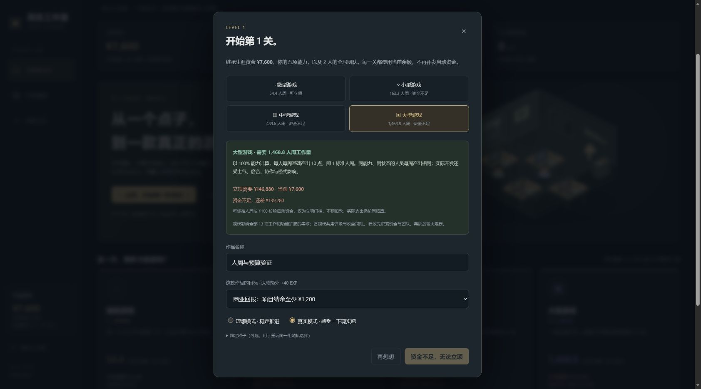

# 周目工作室 · 项目规模与立项资金 Demo v0.8.0

游戏开发题材的回合制肉鸽经营 Demo。每周支付开发成本、安排人物推进完成度、处理一次随机事件。没有固定回合上限，没有任务系统。双击根目录 `index.html` 即可离线试玩，无需安装或联网，声音默认关闭。



士气、技术债数值旁提供问号按钮：鼠标悬停或键盘聚焦预览说明，点击后固定；再次点击、点击空白处、关闭按钮或 Esc 可关闭。说明根据当前数值显示产出系数、维护费与品质影响，触屏可直接点击。

## 四档项目规模

立项分类由叙事冒险、动作闯关、模拟经营改为按规模选择。四档基础工作需求按 1 : 3 : 9 : 27 增长，全部 13 项工作都适用，包括上架与宣发。功能扩展和解冻追加的工作也按规模放大。

| 规模 | 需要的标准人周工作量 | 立项所需资金 | 主角首周推进玩法 |
| --- | --- | --- | --- |
| 微型游戏 | 54.4 人周 | ¥5,440 | 20.1% |
| 小型游戏 | 163.2 人周 | ¥16,320 | 6.7% |
| 中型游戏 | 489.6 人周 | ¥48,960 | 2.2% |
| 大型游戏 | 1,468.8 人周 | ¥146,880 | 0.7% |

100% 能力每周基础产出 10 点，等于 1 标准人周。标准人周总量以全部 13 项基础工作做到 100% 计算，不含功能追加，不计士气、磨合、协作、节奏和模式等修正。示例主角能力 100%、正常节奏、士气 90、独自负责玩法、无磨合，每周产出相同的 **9.66 点工作**。主攻功能及其 1.5 倍加成已移除。

完成度 = 已完成工作 ÷ 该项总需求。界面保留百分比为主要进度，同时显示已完成点数、需求点数和本周基础产能。同能力、岗位、节奏、状态与协作条件下，产出不随规模变化。依赖、软上限和真实模式的分段效率仍影响实际推进；上架虽无软上限，仍需完成全部资料与审核。

立项门槛暂按 **¥100 / 标准人周** 计算，使用当前继承的生涯余额校验。资金不足时显示缺口并禁止启动，启动逻辑也会校验；刚好达到门槛即可启动，不预扣款，实际开发仍逐周支付。该门槛不是保证完成项目的成本报价，实际费用随团队、事件与开发策略变化。各规模共用评级、收益和工资规则，规模只放大工作需求。题材保留为内容工作；规模保存在项目、结算和作品履历中。

## 全局生涯

移除技术蓝图、蓝图抽选、开局角色模板及开局加成卡。开始项目时只选择作品名称、规模、目标和模式，直接进入开发。人物能力与资金属于局外生涯；所有已加入的伙伴与结识名单也跨关保留。

- **主角能力**：新生涯五项能力均为 100%。关卡之间可训练，每次 +5、最高 200%。训练消耗 `40 +（当前能力 − 100）× 2` EXP，不扣资金。项目开发中不能训练或改名，结算后可以继续成长。
- **生涯资金**：只在新生涯提供一次 ¥7,600。开发、邀请、暂别、功能、投放等支出直接扣余额；事件和发行预付款直接入账；发售的自然收入与买量回款在结算时到账。下一关继承实际结余，不再发启动金，切换模式也不会重置资金。
- **全局团队**：主角与阿策为固定成员。已加入的伙伴自动进入后续关卡，继续计算工资；新项目不重复支付邀请费。已结识但未邀请的人也会保留。关卡之间可邀请或暂别，项目内同样可管理，每周一次管理行动。
- **结识伙伴**：核心平均完成度 30% 结识林绘、沈序，65% 结识唐砚、温衡，完整核心内容结识夏禾、陆简。重复达到里程碑不会重复生成伙伴。结识关系不会因项目终止丢失。
- **暂别伙伴**：花 ¥100，之后不计算工资，结识关系保留。项目内暂别后当关不能再邀请，后续关卡可以重新邀请；局外可再次邀请，准备支出 ¥180。主角与阿策不能暂别，团队最多 8 人。
- **每个新项目重新开始**：13 项完成度、70% 软上限、问题、技术债、士气、功能、事件效果和发行合作。人物、能力、资金和结识关系保持。

项目终止不会返还已经花掉的资金，也不产生发售收入；剩余资金和整个团队仍带入下一关。收入和经验只结算一次，包括获得 0 EXP 的终止项目。余额不足该规模立项门槛，或不足以支付首周团队成本时不能立项，可在局外主动重新开始生涯；此操作会重置能力、资金、团队和履历，界面会先说明并确认。

v0.8 使用一个全新的生涯快照 `loop_studio_career_v8`，同时保存生涯与当前项目，不读取或迁移旧存档。

## 五类工作，十三项完成度

| 分类 | 可推进的工作 | 分类结果 |
| --- | --- | --- |
| 游戏内容 | 题材、玩法、子主题 | 可玩性评级 |
| 程序构架 | 开发进度、系统协作、测试 | 完善度评级 |
| 商业化 | 广告变现、用户付费、IP衍生 | 商业化效果评级 |
| 宣发推广 | 宣传、买量 | 推广效果评级 |
| 上架 | 资料准备、审核进度 | 明确的准备状态 |

每人每周负责一项工作，对应的专业能力决定基础产能。不会的工作不能分配；同岗最有效成员发挥全额产能，其余按 45% 折算。转岗磨合一周，产能 −20%；待命仍计工资。阿策五项能力均为 145%。

内容完成度限制开发可实现的范围，开发支持系统协作和测试。系统协作持续偿还技术债，测试持续修复问题。周内按开始时的完成度和依赖条件结算，不借用同周刚完成的上游成果。

## 完成度与两种模式

刚性上限为 100%，也是评级公式中满完成度的基准。除上架外，11 项工作的初始软上限为 70%，按项保存。随机事件可解锁单项或一类工作的上限，通常每次 +15 个百分点，最高 100%。每周事件还随机提供一个尚未满上限类别的突破机会。

事件不会直接增减当前完成度。解锁上限后仍需安排工作，才会提高实际完成度与评级基础。资金、士气、效率和问题等事件效果仍保留。手动扩大功能范围、解冻会改变完成度计算基数，界面提前显示影响。

**理想模式**稳定推进；**真实模式 · 感受一下现实吧**使用相同的工资规则和生涯余额，按周初完成度分段：

| 周初完成度 | 真实模式工作效果 |
| --- | --- |
| 低于 30% | 正常推进 |
| 30% 至不足 50% | 基础推进的 65% |
| 50% 至 70%（含 70%） | 基础推进的 35%；实际正向推进的 20% 随机扣除另一项非上架工作的完成度 |
| 高于 70% | 增减各 50%，幅度为基础产能的 20%—100% |

牵连按百分点换算，最多扣到 0%；其他工作没有成果可扣时不产生牵连。负向推进仍支付成本。达到上限或 100% 后继续安排，也可能返工。预览只显示可能的区间，不预告随机结果或牵连对象；读取和预览不消耗随机数，保存恢复不重掷。

**上架是例外**：资料准备、审核没有软上限，不减速、不返工，也不会被其他工作牵连。资料准备 100% 后才能推进审核，两项都到 100% 才可发售。其他十一项和评级没有发售硬门槛，宣传和买量可完全跳过。

## 隐藏评级、宣传与买量

四类评级使用 `D- / D / D+ / C- / C / C+ / B- / B / B+ / A- / A / A+ / S- / S / S+`。真实基础值为 `10 + 分类平均完成度 × 65 + 固定随机潜力`，潜力为 −28～+28，再叠加功能和事件修正、限制到 0～100；完善度还扣除问题与技术债。相同完成度可以得到不同评级，完成更多不保证最高评级。潜力在每个项目立项时固定。

评级初始显示 `?????`。宣传完成度 0 / 大于 0 / 25 / 50 / 75 / 100% 对应五个问号逐步减少到零，误差半径由 8 个小档逐步缩小到 0。字母可能偏离真实值，界面同时显示认知范围。宣传不提高其他三类的品质，宣传自身仍计入推广效果。发售时揭晓真实评级。

买量必须安排人手并选择本周预算 ¥100 / ¥300 / ¥600，¥0 暂停。每周只扣一份预算，多人工作不重复扣费；未安排人手不扣费。完成度满后继续安排仍会投放，回款只在发售时到账。综合真实评级按可玩性 40%、完善度 30%、商业化 20%、推广 10% 计算。

| 综合评级 | 买量回款 / 投入（未扣发行分成） |
| --- | --- |
| D- / D / D+ | 15% / 25% / 40% |
| C- / C / C+ | 55% / 70% / 90% |
| B- / B / B+ | 105% / 120% / 140% |
| A- / A / A+ | 165% / 195% / 230% |
| S- / S / S+ | 270% / 320% / 380% |

核心平均 30% 后，可取得每项目一次的发行预付款 ¥2,200，代价是发售收入分成 22%，自然收入和买量回款均扣分成。C、D 档买量必亏，B 档起有回本机会。自然收入还受功能数量与 ±15% 市场波动影响。

项目结余为本项目收入、事件收入及融资，减本项目支出；不包含原有生涯资金。结算后资金 = 项目开始资金 + 项目结余。目标可选结余至少 ¥1,200 或综合评级 A-，达成额外 +40 EXP。

## 构筑与验证

功能扩展、范围冻结、开发节奏和人员分配继续保留。内容平均 60% 可冻结范围：程序、美术效率 +12%，新问题 −25%，不能增删功能；解冻花 ¥180 并增加玩法范围和技术债。每项功能增加 ¥22/周维护。

需要 Node.js 18+，无第三方依赖：

```sh
npm run build
npm test
```

修改 `dist/` 后重新生成根目录离线单文件。纯规则位于 `dist/engine.js`，人物卡在 `characters-ui.js`，交互和单快照保存位于 `app.js`。

自动验证通过 39 组通用规则、16 组完成度、18 组生涯、15 组规模检查、23 局合法操作模拟、160 次随机结果及 120 次预览区间验证。包括各规模立项资金差 ¥1 时拒绝且不改生涯、刚好达标可启动且不预扣、两种模式同薪与无主攻产出。报告见 `tests/verification.json` 与 `tests/scale-verification.json`。长流程规模模拟显式提供 30,000 × 规模倍率的测试资金，不代表新生涯余额或胜率。

浏览器验证新生涯 ¥7,600 仅可启动微型项目；大型项目显示 ¥139,280 缺口并禁用启动。切换规模保留名称和模式。真实模式首周工资 ¥168、维护 ¥90，扣款 ¥258，主角推进玩法 9.66 点；刷新保持资金、进度与模式。终止后继承 ¥7,342，下一理想模式项目不预扣款，首周成本仍 ¥258。320px 视口下工作台、立项框与数值说明无横向溢出。记录见 `tests/browser-verification.json`。

这些示例与规则检查不代表玩家胜率或最终平衡。伙伴关系和上架流程均为游戏化设定。MIT 许可见 `LICENSE`。
