# 天才程序员带我做游戏 · Demo v0.13.0

游戏开发题材的回合制肉鸽经营 Demo。每周支付开发成本、安排人物推进完成度、处理一次随机事件。没有固定回合上限，没有任务系统。项目可以暂停、恢复和互相切换，同一时间只推进一个项目。双击根目录 `index.html` 即可离线试玩，无需安装或联网，声音默认关闭。

**[▶ 在线试玩：天才程序员带我做游戏](https://fuhao-dev.github.io/loop-studio-demo/)**

试玩页由 GitHub Pages 从 `main` 分支根目录发布，支持电脑与手机浏览器；进度保存在当前浏览器本机。

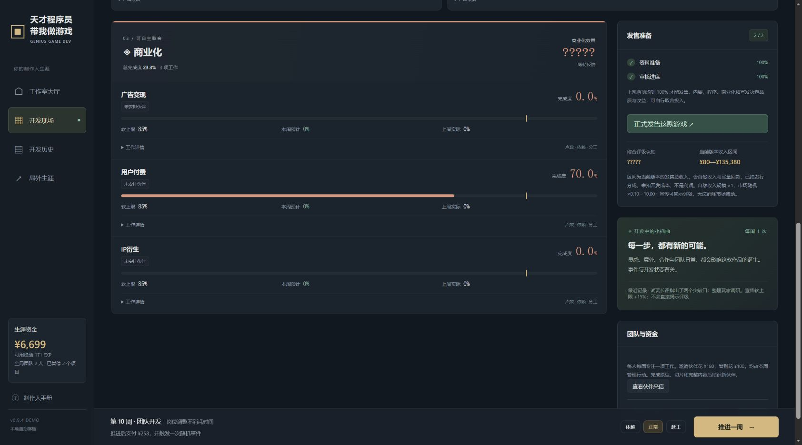

## v0.13.0：发行商预算、规模投放与市场保底

签约后的买量预算由发行商决定，界面只读，规则层也拒绝玩家修改。预算按项目规模和当前**已揭示评级区间的中位预期**逐周更新；完全未宣传按中性 B 档预期，完整揭示后按公开综合评级。C／D、B、A、S 档在微型项目分别采用 ¥100／¥300／¥1,000／¥2,000，再乘规模倍率。该决策不读取未揭示的真实评级，也不抽取市场随机数。本周预算在推进前冻结，宣传变化只影响下周；暂停项目停止发行工作和投放。发行商仍垫付买量并承担亏损，原有分成规则保留。

独立发行保留 ¥0 暂停及五档正预算；所有正档位同乘规模倍率，最大为最小的 **20 倍**。无买量人手时不扣费，预算不足时不能推进。

| 项目规模 | 可选每周正预算 | 发行商未宣传时预算 |
| --- | --- | --- |
| 微型 | ¥100／300／600／1,000／2,000 | ¥300 |
| 小型 | ¥300／900／1,800／3,000／6,000 | ¥900 |
| 中型 | ¥900／2,700／5,400／9,000／18,000 | ¥2,700 |
| 大型 | ¥2,700／8,100／16,200／27,000／54,000 | ¥8,100 |

结束项目时，若资料准备与审核均为 100%，弹框会提示可以发售，并提供查看发售方案的入口；玩家仍可选择仅回收部分投入。暂停作品同样适用，点击发售入口会明确切换到对应作品，先暂停其他开发，再打开正式发售确认；不会直接发售，也不因查看提醒消耗随机数。当前事件尚未完成时，需先处理事件。

市场保持原来的对数分布抽样 ×0.10～10.00，随后按**综合真实评级**托底：B−／B／B+ 最低 ×0.50，A−／A／A+ 最低 ×1.00，S−／S／S+ 最低 ×2.00；C／D 档保持 ×0.10。低于保底直接取保底，较高抽样保持不变，上限仍为 ×10。保底作用于规模后的自然销售收入、发行分成之前，不改变买量回款比例。宣传尚未揭示的品质不会通过预估下限提前泄露；预估只使用公开信息能确认的保底，发售报告显示实际系数及本作保底。

全部 **288 组规则检查**和 UI 检查通过，包括 23 个模拟发售项目、新增 15 组预算／保底／发售提醒检查，以及全部 15 个评级子档的冷门保底和热门上限。Edge 实测签约后只读预算从首周 ¥300 调整至下周 ¥100，四周完成上架；从暂停作品的结束弹框切换并发售后，原开发项目保留暂停状态。结算及刷新保持一致，发行商承担 ¥360 买量亏损；320px 提醒无横向溢出，控制台无错误。记录见 [v013-browser-verification.json](tests/v013-browser-verification.json)。

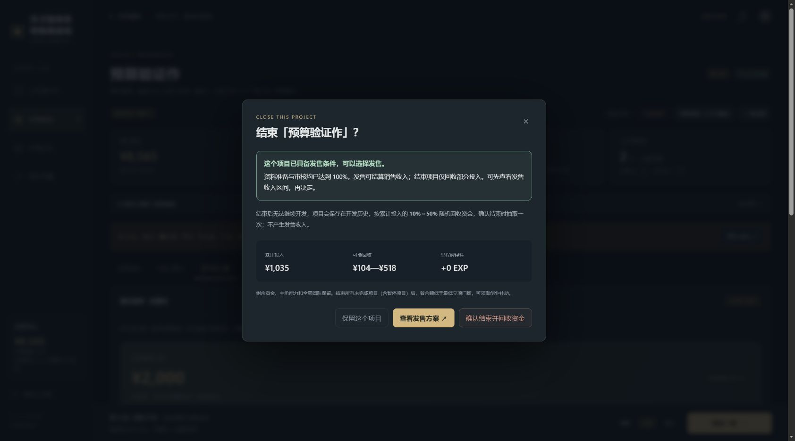

后续各版本章节为历史记录，冲突时以上述当前规则为准。

## v0.12.0：25 名像素伙伴与人物能力评级

候选伙伴从 6 名扩充到 **25 名**，保留原有六位伙伴的能力。取消开发中、局外邀请、存档校验及界面中的 8 人编制限制；当前全部伙伴加主角与龙娘可组成 **27 人团队**。每人仍每周专注一岗，同岗协作、周薪、维护费和每周一次管理行动照常计算，团队跨项目继承。

人物能力分 = 最高能力 ×60% + 次高能力 ×25% + 其余三项平均 ×15%。基础能力决定评级，士气、临时效率及转岗磨合不改变评级。主角不评级；天才程序员保留五项 145%，以龙角图案标记特殊 **EX**。UR 大师可在其专长上超过龙娘，EX 保持全能特色。

| 评级 | 能力分 | 人数 | 图案 | 候选伙伴 |
| --- | --- | --- | --- | --- |
| N | ＜80 | 6 | 灰色圆章 | 余苗、池川、墨小雨、乔安、乐小满、宁禾 |
| R | 80～＜110 | 6 | 蓝色菱形 | 何知、游弈、秋染、程谨、苏晴、赵平 |
| SR | 110～＜135 | 6 | 紫色四芒星 | 林绘、沈序、唐砚、陆简、纪澄、白露 |
| SSR | 135～＜165 | 4 | 金色六芒星 | 温衡、夏禾、许望、韩栈 |
| UR | ≥165 | 3 | 红金皇冠 | 顾星河、零一、商时雨 |

12 名 N/R 伙伴初始结识，其余按可玩原型、垂直切片和内容完成里程碑解锁。25 人均可在候选图鉴预览，显示未结识条件，支持评级筛选；邀请仍需 ¥180 准备支出。每位普通伙伴都有不会的能力，低档角色工资更便宜。人物卡、工作分配及局外团队均展示图案和评级字母。

全部 27 位人物采用原生像素风立绘，区分发型、肤色、服装、眼镜、耳机、帽子及职业道具；龙娘保留白发、龙角与龙尾。画面随单文件构建内嵌，离线可见。

自动分配为 **10 人及以内的团队保留全局最优计算**；更大的团队从现有分工和两组新分工出发，搜索岗位调换及人员交换，计入转岗、协作、上限、依赖与预算，不保证全局最优。无改进提示据此区分说明；预算为零或无力支付的买量不会被当成有效产出。此变化避免扩大团队后产生指数级内存占用。

全部 **273 组规则检查**及 UI 检查通过，含 23 个模拟发售项目、新增 15 组伙伴与大团队检查、30 组 27 人分配场景、全员招募、暂停恢复和跨项目继承。浏览器实测招募 9 位伙伴形成 11 人团队，刷新保持、立项正常、自动分配可用，推进一周准确扣除 ¥1,253；主角无徽章、龙娘为 EX，320px 界面无横向溢出。证据见 [roster-browser-verification.json](tests/roster-browser-verification.json)。

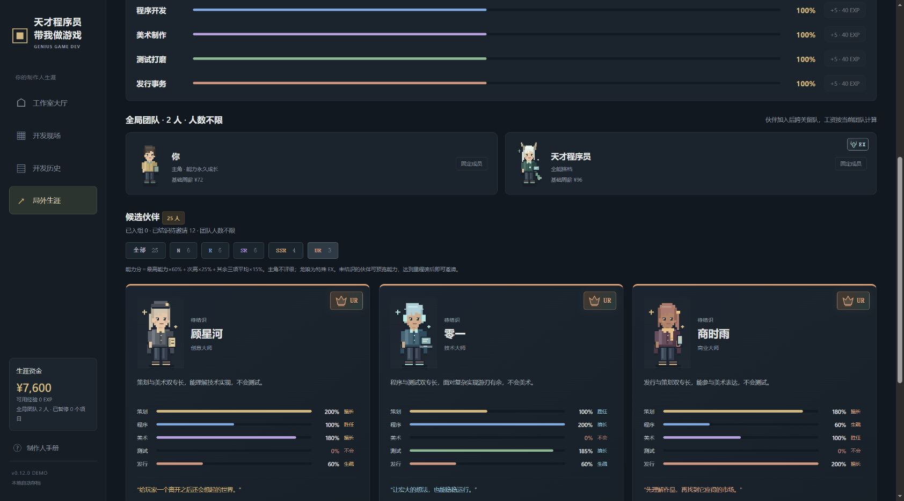

## v0.11.0：简化数值、扩充共享场景事件

移除“问题”和“商业化潜力”，连同事件直接增加评级潜力的机制。事件不再生成问题、修复问题或累计潜力；相关奖励改为完成度软上限、临时效率、士气、技术债或资金。测试仍是一项独立工作，通过测试完成度影响完善度；满进度后不再产生额外修复收益。评级仍依据完成度、项目固定随机值及技术债计算，市场波动保持原规则。

事件由 48 个扩充到 **120 个**：常规 36、纯过渡 36、隐藏后果 36、发行商建议 12，保留原有事件并调整其失效效果。

- **36 个共享日常场景**：每个场景都有纯过渡和隐藏后果两个版本，标题、正文、人物发言、选项文字、标签及样式在选择前完全一致。同样遇见窗边的猫、收到纸箱或听见水壶响，既可能无事发生，也可能选择后才获得效果。
- **交叉使用情境**：12 个常规事件、4 个发行商建议也采用上述日常背景。常规事件仍明确显示效果；发行商建议仍显示身份与协助内容，只有纯过渡与隐藏后果隐藏类别及效果。
- **按现状筛选**：结合当前资金、士气、技术债、分工、发行合约、依赖、完成度及上限调整事件池；无法产生收益的测试效率等选项退出。共享场景跨类别也不会连续重复，普通独立事件仅排除自身，不影响其他事件刷新。
- **发行商协助范围**：所有 12 个建议仅协助游戏内容、程序构架和商业化，不推进或提高宣传、买量、资料准备、审核四项托管工作的上限。

全部 **258 组规则检查**及 UI 检查通过，包括 23 个模拟发售项目、36 组场景的选前对照、1,400 组种子抽样及连续 200 周场景冷却验证。浏览器实测同一场景相同选项一次无变化、一次士气 +4，选择前展示完全一致；刷新保持结果且不重复生效，320px 窄屏无横向溢出。记录见 [v011-browser-verification.json](tests/v011-browser-verification.json)。

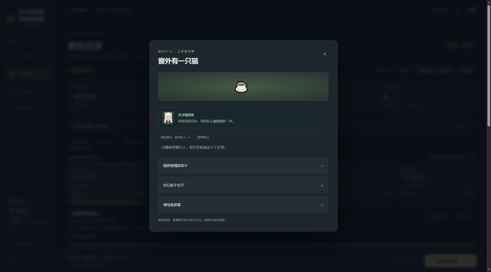

以下为各历史版本的功能记录，数值与事件以 v0.13.0 为准。

## v0.10.2：开发中的日常、意外与发行商建议

保留原有 24 个事件，新增三类各 8 个，目前共 **48 个事件**：

- **纯过渡日常**：午饭投票、窗边的猫、命名分支等，提供多个选项，任何选择都不改变资金、完成度、软上限、问题、技术债、士气、潜力或效率。
- **隐藏后果**：选择前与普通日常采用完全相同的标签、图标和选项样式，只显示选项文字，不显示效果、提示、数值或禁用原因。选择后才展示故事结果和实际变化，包括被上限截断后的真实收益、效率幅度与持续周数。结果自动保存；刷新、暂停恢复、重复点击都不会再次结算。
- **发行商建议**：仅签约项目进入此事件池。发行商代表只协助玩家负责的游戏内容、程序构架、商业化三类工作，可直接推进完成度或提高对应软上限。宣传、买量、资料准备、审核属于发行商日常托管范围，建议事件不能直接推进这四项，也不能提高其软上限。直接协助不消耗人物行动或额外收费，理想与真实模式均为正向；仍受软上限、刚性 100% 和当前上游依赖限制，不改变买量预算或既有分成。

事件在每周工作与状态结算后重新筛选。问题、技术债、士气、当前资金、规模、团队、买量预算、发行合约、完成度、软上限和依赖决定事件及选项是否可用。已满的上限、无法推进的工作、已完成的上架和无需求的维护会被排除；正在触顶的岗位、紧张现金流和较重问题获得更高相关权重。各类型先按权重抽取，再在类型内按相关度抽取；普通日常提供稳定的兜底池，不连续重复同一事件。

当前周已经抽到的选项会固定保存，避免刷新、暂停恢复后选项下标改变。原有事件的额外复盘解锁选项保留；日常、隐藏后果和发行商建议不会被追加这个选项。完成原型等工作里程碑在周结算时检查，发行商直接推进产生的新里程碑在建议落实后检查。

已通过 **246 组规则检查**及 UI 检查，包含 23 个模拟发售项目、新增 27 组事件检查和 480 组带种子的事件抽样。发行商所有建议逐项验证仅影响三类玩家工作，不能改变四项托管工作的完成度、软上限、宣传揭示或买量支出；非法目标在结算前直接拒绝。浏览器验证记录见 [events-browser-verification.json](tests/events-browser-verification.json)。

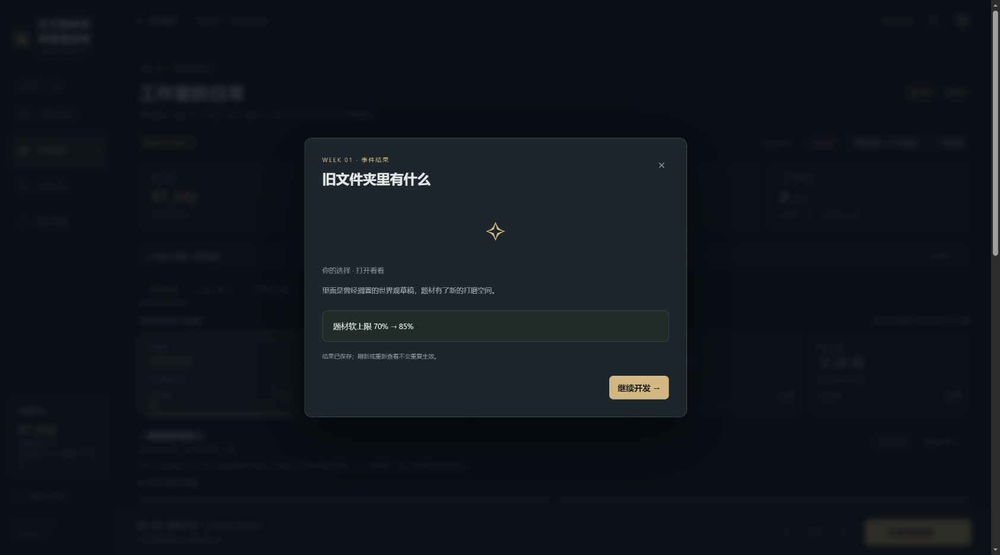

## v0.10.1：自动分配人物工作

开发现场的人物工作选择区域及“团队人物”页增加 **自动分配**。点击一次立即计算并调整全体人物岗位，不消耗周数、资金、管理行动或随机数。若当前分工已经无法改善，弹出“无法优化任务分配了”，保留原岗位。

优化目标是 **本周 13 项工作的平均完成度预估增量最大**，与当前满效率预估一致。计算计入能力、上周实际岗位产生的转岗磨合、同岗协作折损、软上限、100% 刚性上限及按周初状态计算的上游依赖。不会的工作和发行商托管岗位不会分配给人物；已有买量预算保持不变，避开资金不足以支付的新增买量安排。同收益时优先保留已有分工，减少变化。

采用人物子集动态规划计算全局最优，最多 8 人；通过独立遍历小团队的全部合法分工组合核对最优结果。真实模式按满效率优化，不读取或预判随机结果。自动分配的目标不包含偿债、修复问题或未来周收益，玩家可按自己的长期策略手动调整；“自动分配怎么算？”可展开查看规则。

全部 **219 组规则检查**及 UI 检查通过；新增 19 组自动分配检查，包含 10 个穷举最优解对照案例、满 8 人、转岗、上限、依赖、买量预算、隐藏信息、暂停/事件阻塞、重复点击及存档。浏览器验证首次调整、最优提示、刷新保存、双入口、事件阻塞和 320px 窄屏，记录见 [auto-assignment-browser-verification.json](tests/auto-assignment-browser-verification.json)。沿用 v10 存档，可继续 v0.10.0 生涯。

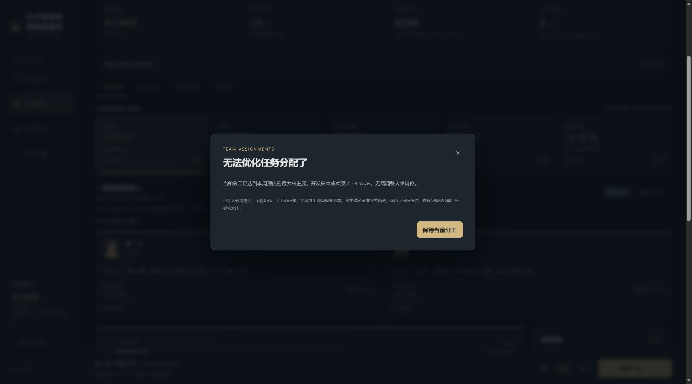

## v0.10.0：签约发行商

移除功能规划、功能扩展与范围冻结。原页签改为“签约发行商”，独立发行仍可选择。

- **预付款**：按规模及玩家已揭示评级的中位预期计算，取基准自然收入的 60%，四舍五入至百元，最低 ¥100。未宣传时按中性预期报价，微型 / 小型 / 中型 / 大型初始报价为 ¥2,000 / ¥5,900 / ¥17,600 / ¥52,700。报价不读取隐藏潜力、实际市场结果或买量回款，不抽取随机数。每作仅签约一次，预付款立即计入其他收入，无需在结算时归还。
- **四项托管**：宣传、买量、资料准备、审核每周各产出 20 点基础工作（2 标准人周），不占用人物或增加工资。遵守规模、软上限、上游依赖和模式规则；资料 100% 后下一周才能推进审核。四个托管岗位不可手动分配，原岗位成员转为待命，可另行分工。暂停项目时，发行工作和投放同步暂停。
- **买量预算**：签约后默认 ¥300/周，已有正预算则保留。可选 ¥0 / ¥100 / ¥300 / ¥600；¥0 时不投放、不推进买量，其余三项照常。后续费用由发行商垫付，不扣生涯资金，不计工作室累计投入；满进度后仍会继续投放。
- **自然收入**：先按规模与市场系数计算自然销售总额，工作室取得 50%（向下取整），发行商取得其余 50%。
- **发行商买量**：回款先回收垫付成本，再平分正净利润。亏损由发行商承担，工作室不补差。工作室取得正净利润的 50%（向下取整）；回收不足时全部回款归发行商。
- **签约前自投**：单独记账，原成本已扣工作室资金，原投放回款全部归工作室，盈亏自负。签约不会追溯转嫁成本。
- **报表**：区分自然销售总额、双方自然分成、工作室自投、发行商垫付、成本回收、利润分成、发行商承担亏损及工作室实收。收入区间预估工作室可到账收入；预付款已经到账，不在发售时重复计算。

例如发行商投放 ¥1,000：评级回款比例 120% 时回款 ¥1,200，发行商收回 ¥1,000 并分得 ¥100 利润，工作室得 ¥100；比例 70% 时回款 ¥700，全归发行商，发行商承担 ¥300 亏损，工作室无需补差。结束项目只按工作室实际投入回收，不把发行商垫付纳入回收基数。

v0.10.0 完成时全部 **200 组规则检查**与 UI 检查通过，包含 23 个模拟发售项目、新增 17 组发行规则检查、30 组评级/买量归属组合、120 组混合买量收入区间与 80 组隐藏报价检查。浏览器验证记录见 [publisher-browser-verification.json](tests/publisher-browser-verification.json)。

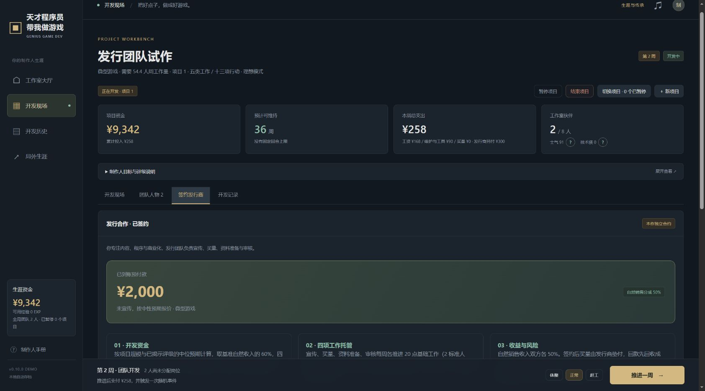

## v0.9.5：结束项目、资金回收与收入揭示

创业补助仅在**全部项目已发售或结束**且余额低于微型立项门槛 ¥5,440 时开放，领取后补足到 ¥7,600。开发中及暂停中的项目均算未完成，低资金时会说明仍有多少项目需要处理，不能通过暂停反复领取。补助只改变生涯余额，历史报告和项目盈亏保持不变。

开发现场顶部及开发历史中的活动/暂停项目均提供“结束项目”。确认框显示累计投入、可能回收范围和里程碑经验；确认后无法恢复。回收比例在 **10%～50%** 中按整数百分比等概率抽取，金额按累计投入取整；未投入时不抽取，回收为零。结果和结算凭证保存，重复点击、刷新、再次结算不会重复回收。结束暂停项目不需要先恢复，即使资金耗尽或有待处理事件也能结束；若另一项目正在开发，只同步回收到账，不改变其进度、团队、事件或随机状态。

回收资金在开发历史和结算报告中单列，不算发售收入。项目结余 = 自然收入 + 买量总回款 + 回收资金 + 事件/预付款收入 − 累计投入；买量费用只扣一次。未发售作品不揭示真实评级，也不抽取市场系数，不获得制作人目标奖励。

“当前版本收入区间”初始显示 **?????**。宣传开始后解锁粗略区间，宣传达到 **25%、50%、75%、100%** 时逐档增加金额精度，并随评级认知缩小预估范围。低档区间向外取整并标注“约”，避免暗示更高精度；100% 宣传仍保留市场波动范围，实际收入在发售时揭晓。制作人目标的预计结余、买量总回款/净回款及比例、发售确认框使用同一揭示规则，累计投入始终明确可见。宣传仍为可选工作，未宣传也能正常发售。

v0.9.5 发布时 **183 组规则检查**与 UI 检查通过；该版新增 20 组，包含 400 个回收样本、400 组收入揭示用例、跨项目账目、暂停与事件阻塞、重复结算、补助门槛和隐藏信息一致性。浏览器验证记录见 tests/v95-browser-verification.json。

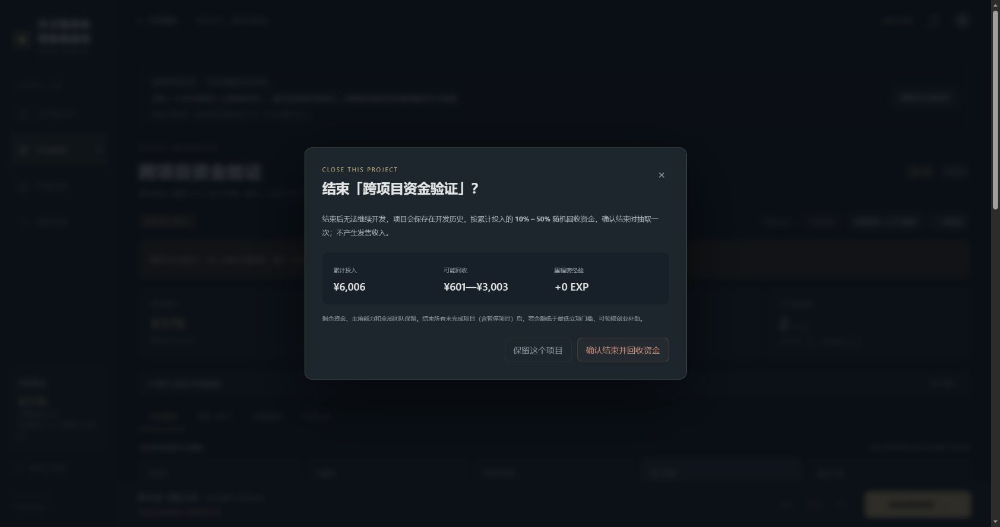

## v0.9.4：进度卡、买量收支与当前版本事件

工作卡默认显示大号完成度、带软上限刻度的进度条，以及软上限、本周预计、上周实际三列数值。受上游限制、抵达上限、零预算和真实模式风险等关键状态直接显示。展开“工作详情”可查看完成/需求点数、基础产能、刚性上限、依赖名称及数值、分工、能力和模式规则；人物预估的计算说明放在“产出依据”中，信息保留但不反复铺开。上架工作明确标记无软上限与 100% 目标。

买量预算为 ¥0 时，岗位选项、人物预估、工作卡和推广设置均提示本周买量无进度。有人负责买量却没有预算，推进前会弹框提醒，可直接前往设置预算、返回调整分工或明确继续；取消不推进、不扣款、不改变随机数。未安排人手不投放，预算为零也不扣投放费，团队工资仍照付。

买量收支统一区分 **总回款** 和 **净回款**：`净回款 = 总回款 − 累计买量投入`。推广账目、发售确认和结算报告均展示两者；负值清楚显示为 `−¥75`。例如投入 ¥100、D 档回款比例 25% 时，总回款 ¥25，净回款 −¥75。发售总收入仍包含买量总回款；买量投入已经计入累计成本，计算项目结余时只扣一次。

随机事件从 14 个增加到 **24 个**，原事件文案也按当前五类十三项工作、全局生涯、软上限、规模收益和市场随机更新。新增广告变现、付费方案、IP 衍生、零预算买量、商店资料、规模复盘、竞品观察、市场报告、现金流复盘、伙伴交流事件，按相关工作、预算、项目规模、资金或团队情况进入事件池。事件可解锁上限、改变资金、士气、效率或问题，不直接增减当前完成度；解锁上限后仍需工作，市场际遇仍在发售时抽取。

新增 14 组检查，全部规则检查共 **163 组**；另验证 30 组不同评级/分成的买量结算、160 组事件选择以及 24 个事件。浏览器验证零预算弹框取消保持第 4 周与 ¥8,347；改为 ¥100 后一周扣款 ¥358（工资维护 ¥258 + 买量 ¥100），买量实际推进 28.3%。发售报告为买量总回款 ¥25、净回款 −¥75、自然收入 ¥1,349、项目结余 −¥928；生涯余额从 ¥6,699 增至 ¥8,073，刷新回看一致。320px 视口下工作卡和提示框没有横向溢出。记录见 `tests/v94-browser-verification.json`。

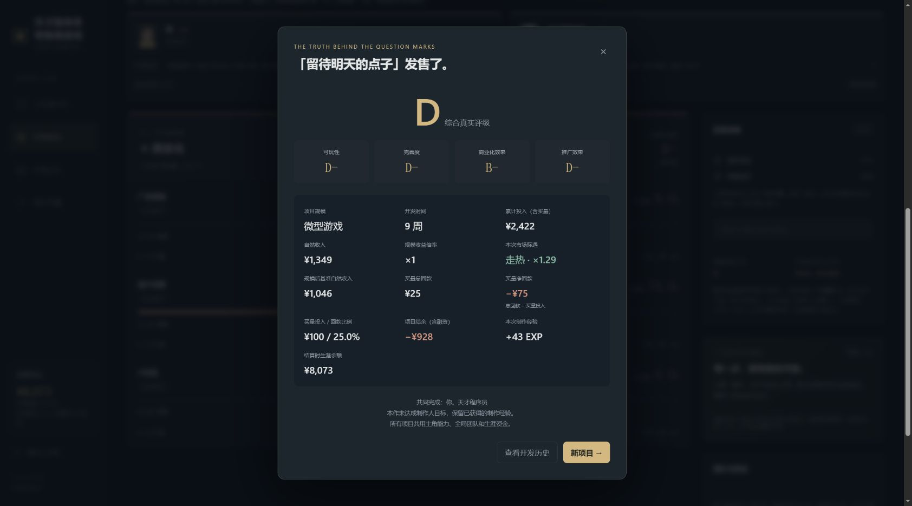

士气、技术债数值旁提供问号按钮：鼠标悬停或键盘聚焦预览说明，点击后固定；再次点击、点击空白处、关闭按钮或 Esc 可关闭。说明根据当前数值显示产出系数、维护费与品质影响，触屏可直接点击。

## 产出预估

四项有上游依赖的工作（开发进度、系统协作、测试、审核进度）会显示上游名称、当前完成度及允许的上限，统一按周初完成度计算。

人物卡和开发现场的团队条不再把基础推进当作实际变化：基础产能使用工作“点”，本周岗位预计使用周结算同一份预览中的完成度净变化，包含软上限和上游依赖；真实模式按满效率预估，阶段减速、随机返工、随机牵连均不计入预估数值。多人同岗时明确标注“同岗合计”；有待处理事件时暂不显示完成度预估。

例如天才程序员基础产能对应 22.5%，但开发进度距当前上游允许的上限只剩 5.5% 时，卡片显示“本周岗位预计 +5.5%”，并提示受上游完成度限制。真实模式显示排除阶段减速及随机影响的满效率预估，明确提示实际可能不同，不提前透露本次随机结果。

## 岗位选项与上限提醒

每个人的岗位下拉选项显示该工作的当前完成度、软上限（上架标记无软上限）、选岗后的预计进展和该人物的能力。选岗预计会模拟这次分工调整，计入转岗磨合与同岗协作，按满效率、上游依赖和上限计算该工作团队合计；预估过程不修改项目或随机数。

当前已分配的非上架工作达到软上限时，人物卡和下拉选项突出提醒。推进一周会先弹框列出受影响成员与工作，可返回调整或明确继续；取消不推进、不扣款，确认后仅推进一周。同岗成员合并提示；达到 100% 会标记为完成度已满。系统协作仍可偿债、测试仍可修问题、买量仍可能扣投放费，弹框会分别说明；真实模式高完成度仍可能返工。

## 界面与作品名称

进度变化、上限解锁、事件和开发记录统一使用 `%`，例如 `本周 +20.1%`、`软上限 +15%`；实际工作产出仍使用“点”。这里的 `+15%` 表示上限从 70% 提高到 85%，不改变原有计算。

立项名称使用内置本地词库实时检测常见辱骂、色情和违法招揽等词句。检测到时显示“当前名字不合适，请换个名字。”并禁止立项；改成正常名称后恢复。支持全半角、大小写、零宽字符和常见分隔写法，英文按词边界匹配以减少误伤。规则与 UI 共同校验，不发送名称到外部服务；词库为有限集合，可在 `dist/engine.js` 中维护。

开发现场、团队人物、签约发行商和开发记录统一使用同一个可折叠的“制作人目标与评级说明”面板；切换页签、工作模块及其他页面时保留当前展开状态，刷新后默认折叠。

## 项目暂停与开发历史

固定搭档改名为 **天才程序员**，人物描述为“白发有角龙娘，强的可怕。”；头像也改为白发、有角的龙娘，五项能力仍为 145%。

- 开发现场提供“暂停项目”和“切换项目”。暂停不结算经验、不返还成本，不产生开发周成本，保留完成度、分工、士气、问题、技术债、发行合约、软上限、随机数与待处理事件。
- 暂停后可以立项；恢复另一个项目时，当前项目自动暂停。同一时刻最多一个项目开发，暂停的项目不能工作、消费或处理事件。
- 资金、主角能力、伙伴和结识名单仍为全局属性。恢复时使用当前余额和最新团队，不会取回暂停前的钱；原成员保留分工，新成员按擅长岗位加入并经历磨合。暂停期间可以在局外训练或管理团队。
- 新立项仍需满足规模资金门槛；恢复旧项目不再检查立项门槛，是否能够推进下一周仍按实际余额判断。
- “开发历史”集中展示开发中、已暂停、已发售、已终止的产品；支持按状态筛选，查看规模、模式、开发周数、完成度、投入、发售收入、项目盈亏、各模块进度、制作团队和结算报告。
- 项目编号在立项时分配，按立项顺序递增。历史记录按编号排列；恢复较早项目、先发售较新项目都不会重号或退回编号。
- 项目盈亏只统计该项目收入和成本。恢复时共用余额的变化单独记录，结算不会把其他项目的支出算成自己的成本，也不会重复获得收入或经验。

## 四档项目规模

立项分类由叙事冒险、动作闯关、模拟经营改为按规模选择。四档基础工作需求按 1 : 3 : 9 : 27 增长，全部 13 项工作都适用，包括上架与宣发。签约后的发行团队同样每周推进固定工作点数。

| 规模 | 需要的标准人周工作量 | 立项所需资金 | 主角首周推进玩法 |
| --- | --- | --- | --- |
| 微型游戏 | 54.4 人周 | ¥5,440 | 20.1% |
| 小型游戏 | 163.2 人周 | ¥16,320 | 6.7% |
| 中型游戏 | 489.6 人周 | ¥48,960 | 2.2% |
| 大型游戏 | 1,468.8 人周 | ¥146,880 | 0.7% |

100% 能力每周基础产出 10 点，等于 1 标准人周。标准人周总量以全部 13 项基础工作做到 100% 计算，不计士气、磨合、协作、节奏和模式等修正。示例主角能力 100%、正常节奏、士气 90、独自负责玩法、无磨合，每周产出相同的 **9.66 点工作**。主攻功能及其 1.5 倍加成已移除。

完成度 = 已完成工作 ÷ 该项总需求。界面保留百分比为主要进度，同时显示已完成点数、需求点数和本周基础产能。同能力、岗位、节奏、状态与协作条件下，产出不随规模变化。依赖、软上限和真实模式的分段效率仍影响实际推进；上架虽无软上限，仍需完成全部资料与审核。

立项门槛暂按 **¥100 / 标准人周** 计算，使用当前继承的生涯余额校验。资金不足时显示缺口并禁止启动，启动逻辑也会校验；刚好达到门槛即可启动，不预扣款，实际开发仍逐周支付。该门槛不是保证完成项目的成本报价，实际费用随团队、事件与开发策略变化。各规模共用评级、买量回款和工资规则；微型、小型、中型、大型分别将工作需求与自然收入放大 1、3、9、27 倍。题材保留为内容工作；规模保存在项目、结算和作品履历中。

## 创业补助与收入计算

全部项目已发售或结束后，若余额低于最低立项门槛 **¥5,440**，可在工作室大厅、开发现场、开发历史、局外生涯及立项窗口领取创业补助。点击补足至初始资金 **¥7,600**，不是额外加 ¥7,600；无需偿还。暂停项目仍属未完成，不可领取。后续再次满足“全部结束且资金不足”时可再领，余额刚好 ¥5,440 不符合条件，重复点击不叠加。

补助不消耗周数、不重掷随机数，也不清空能力、经验、伙伴或开发历史。领取时不存在开发中或暂停中的项目。补助不计入作品收入、盈利或商业回报目标，历史报告保留实际盈亏。立项窗口领取后保留名称、目标、模式和种子。

当前收入规则：综合分数 Q = 可玩性 ×40% + 完善度 ×30% + 商业化 ×20% + 推广 ×10%，C 为商业化分数，均在 0—100。自然收入基础值为：

`(1000 + 0.9 × Q²) × (0.65 + 0.007 × C) × 事件销售系数 × 规模收益倍率`

实际自然收入再乘 **0.10—10.00 倍市场随机系数**，按现有逻辑取整。市场系数按对数分布抽取：`round(0.1 × 100^U, 2)`，U 在 0—1 均匀随机。约一半遇冷（小于 1 倍）、一半走热（大于 1 倍），不是均匀抽取倍数；同品质、同规模最高与最低自然收入相差 100 倍。随机成为收入最大的单项变因，好作品也可能滞销，普通作品也可能爆红。买量回款另外计算为累计买量投入 × 综合评级回款比例 × (1 − 发行分成)。收入预估使用宣传揭示的认知上下界，同时包含自然收入、市场波动及买量回款；这是发售总收入，未扣开发成本，不是利润。宣传为零时区间隐藏；宣传开始后从粗略区间逐步提高精度，100% 时完整显示当前认知区间，仍包含市场波动。

例如 Q=50、C=50，无事件销售修正、发行分成和买量时，各档自然收入如下（按金额取整）：

| 规模 | 收益倍率 | 市场 1 倍时 | 市场随机后的范围 |
| --- | --- | --- | --- |
| 微型 | ×1 | ¥3,250 | ¥325—¥32,500 |
| 小型 | ×3 | ¥9,750 | ¥975—¥97,500 |
| 中型 | ×9 | ¥29,250 | ¥2,925—¥292,500 |
| 大型 | ×27 | ¥87,750 | ¥8,775—¥877,500 |

宣传只缩小评级认知误差，无法消除市场随机性。即使四类评级完全揭示，发售前仍保留市场造成的收入区间；不提前生成或泄露本次市场结果。成功发售只抽取一次，暂停、预览和终止不抽取，保存与结算重复操作不重掷。结算报告记录规模倍率、规模后基准自然收入及实际市场系数。市场和规模倍率只影响自然收入，买量继续按真实评级比例回款，以保留低评级买量亏损规则。

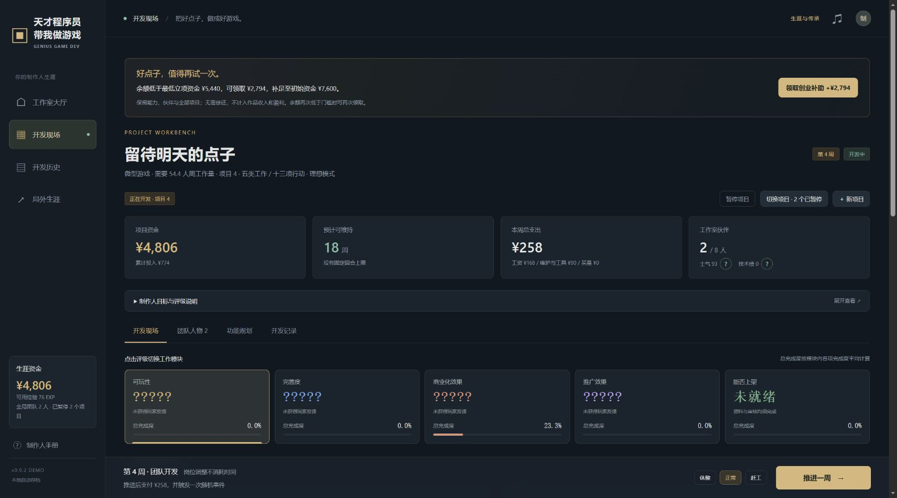

## 全局生涯

移除技术蓝图、蓝图抽选、开局角色模板及开局加成卡。开始项目时只选择作品名称、规模、目标和模式，直接进入开发。人物能力与资金属于局外生涯；所有已加入的伙伴与结识名单也跨关保留。

- **主角能力**：新生涯五项能力均为 100%。关卡之间可训练，每次 +5、最高 200%。训练消耗 `40 +（当前能力 − 100）× 2` EXP，不扣资金。项目开发中不能训练或改名，结算后可以继续成长。
- **生涯资金**：新生涯初始资金为 ¥7,600。开发、邀请、暂别、自投买量等支出直接扣余额；事件和发行预付款直接入账；发售的自然收入与买量回款在结算时到账。下一关继承实际结余，不自动发启动金，切换模式也不会重置资金。全部项目结束且余额不足最低立项门槛时，可主动领取创业补助。
- **全局团队**：主角与天才程序员为固定成员。已加入的伙伴自动进入后续关卡，继续计算工资；新项目不重复支付邀请费。已结识但未邀请的人也会保留。关卡之间可邀请或暂别，项目内同样可管理，每周一次管理行动。
- **结识伙伴**：核心平均完成度 30% 结识林绘、沈序，65% 结识唐砚、温衡，完整核心内容结识夏禾、陆简。重复达到里程碑不会重复生成伙伴。结识关系不会因项目终止丢失。
- **暂别伙伴**：花 ¥100，之后不计算工资，结识关系保留。项目内暂别后当关不能再邀请，后续关卡可以重新邀请；局外可再次邀请，准备支出 ¥180。主角与天才程序员不能暂别，团队最多 8 人。
- **每个新项目重新开始**：13 项完成度、70% 软上限、问题、技术债、士气、事件效果和发行合约。人物、能力、资金和结识关系保持。

结束项目按累计投入随机回收 10%～50%，不产生发售收入；剩余资金、回收金额和整个团队仍带入下一关。回收、收入和经验只结算一次，包括获得 0 EXP 的结束项目。余额不足该规模立项门槛，或不足以支付首周团队成本时不能立项，全部项目结束且余额低于微型项目立项门槛 ¥5,440 时可领取创业补助，补足至 ¥7,600，保留能力、经验、团队和全部履历。仍可主动重新开始生涯；该操作会先说明并确认重置。

v0.10 使用一个全新的生涯快照 `loop_studio_career_v10`，同时保存生涯、当前项目与全部暂停项目，不读取或迁移旧存档。

## 五类工作，十三项完成度

| 分类 | 可推进的工作 | 分类结果 |
| --- | --- | --- |
| 游戏内容 | 题材、玩法、子主题 | 可玩性评级 |
| 程序构架 | 开发进度、系统协作、测试 | 完善度评级 |
| 商业化 | 广告变现、用户付费、IP衍生 | 商业化效果评级 |
| 宣发推广 | 宣传、买量 | 推广效果评级 |
| 上架 | 资料准备、审核进度 | 明确的准备状态 |

每人每周负责一项工作，对应的专业能力决定基础产能。不会的工作不能分配；同岗最有效成员发挥全额产能，其余按 45% 折算。转岗磨合一周，产能 −20%；待命仍计工资。天才程序员五项能力均为 145%。

内容完成度限制开发可实现的范围，开发支持系统协作和测试。系统协作持续偿还技术债，测试持续修复问题。周内按开始时的完成度和依赖条件结算，不借用同周刚完成的上游成果。

## 完成度与两种模式

刚性上限为 100%，也是评级公式中满完成度的基准。除上架外，11 项工作的初始软上限为 70%，按项保存。随机事件可解锁单项或一类工作的上限，通常每次 +15%，最高 100%。每周事件还随机提供一个尚未满上限类别的突破机会。

事件不会直接增减当前完成度。解锁上限后仍需安排工作，才会提高实际完成度与评级基础。资金、士气、效率和问题等事件效果仍保留。签约不改变工作需求与当前完成度。

**理想模式**稳定推进；**真实模式 · 感受一下现实吧**使用相同的工资规则和生涯余额，按周初完成度分段：

| 周初完成度 | 真实模式工作效果 |
| --- | --- |
| 低于 30% | 正常推进 |
| 30% 至不足 50% | 基础推进的 65% |
| 50% 至 70%（含 70%） | 基础推进的 35%；实际正向推进的 20% 随机扣除另一项非上架工作的完成度 |
| 高于 70% | 增减各 50%，幅度为基础产能的 20%—100% |

牵连以完成度变化（%）换算，最多扣到 0%；其他工作没有成果可扣时不产生牵连。负向推进仍支付成本。达到上限或 100% 后继续安排，也可能返工。界面预估按满效率计算，只受上游依赖和完成度上限约束；不计阶段减速、随机返工与牵连，并明确提示与实际可能不同；读取和预览不消耗随机数，保存恢复不重掷。

**上架是例外**：资料准备、审核没有软上限，不减速、不返工，也不会被其他工作牵连。资料准备 100% 后才能推进审核，两项都到 100% 才可发售。其他十一项和评级没有发售硬门槛，宣传和买量可完全跳过。

## 隐藏评级、宣传与买量

四类评级使用 `D- / D / D+ / C- / C / C+ / B- / B / B+ / A- / A / A+ / S- / S / S+`。真实基础值为 `10 + 分类平均完成度 × 65 + 固定随机潜力`，潜力为 −28～+28，再叠加事件修正、限制到 0～100；完善度还扣除问题与技术债。相同完成度可以得到不同评级，完成更多不保证最高评级。潜力在每个项目立项时固定。

评级初始显示 `?????`。宣传完成度 0 / 大于 0 / 25 / 50 / 75 / 100% 对应五个问号逐步减少到零，误差半径由 8 个小档逐步缩小到 0。字母可能偏离真实值，界面同时显示认知范围。宣传不提高其他三类的品质，宣传自身仍计入推广效果。发售时揭晓真实评级。

独立发行的买量需安排人手并选择本周预算 ¥100 / ¥300 / ¥600，¥0 暂停。每周只扣一份预算，多人工作不重复扣费；未安排人手不扣费。完成度满后继续安排仍会投放，回款只在发售时到账。综合真实评级按可玩性 40%、完善度 30%、商业化 20%、推广 10% 计算。

| 综合评级 | 买量回款 / 投入（分配前） |
| --- | --- |
| D- / D / D+ | 15% / 25% / 40% |
| C- / C / C+ | 55% / 70% / 90% |
| B- / B / B+ | 105% / 120% / 140% |
| A- / A / A+ | 165% / 195% / 230% |
| S- / S / S+ | 270% / 320% / 380% |

发行合作已改为本页 v0.10.0 的动态预付款、四项托管与自然销售 50% 分成。买量评级比例不变，但签约后投放由发行商承担成本与亏损。自然收入受规模倍率与 0.10—10.00 倍市场随机影响。

项目结余为本项目收入、事件收入、预付款及回收，减工作室本项目支出；不包含原有生涯资金及其他项目收支。结算后资金 = 项目开始资金 + 暂停期间共用余额变化 + 项目结余。目标可选结余至少 ¥1,200 或综合评级 A-，达成额外 +40 EXP。

## 构筑与验证

功能规划与范围冻结已经移除；策略来自开发节奏、人员分配、上下游依赖、事件选择、独立发行或签约发行商，以及发售时机。

需要 Node.js 18+，无第三方依赖：

```sh
npm run build
npm test
```

修改 `dist/` 后重新生成根目录离线单文件。纯规则位于 `dist/engine.js`，人物卡在 `characters-ui.js`，交互和单快照保存位于 `app.js`。

### TapTap H5 包

沿用周目小镇的上传结构：ZIP 内只有一个英文游戏文件夹 `genius-programmer/`，入口为 `genius-programmer/index.html`；只包含运行单文件和 `LICENSE`，不混入源码目录、截图、测试或 Git 信息。脚本校验包体不超过 300MB、安全路径、唯一顶层目录，并解压逐文件核对 SHA-256。版本与来源提交、大小及哈希写在 ZIP 外的 `manifest.json`。

在仓库根目录执行（需要 Node.js 18+、PowerShell 7+）：

```powershell
pwsh -File scripts/package-taptap-h5.ps1
```

产物默认写到仓库同级的 `taptap-h5-v0.13.0/`。输出目录已有同版产物时会停止，避免覆盖；可通过 `-OutputRoot` 指定新目录。上传 ZIP 时选择 **横屏 / landscape**。包内使用本机存档，不包含 TapTap 登录、云存档、广告或支付 SDK；游戏中的广告变现与买量均为经营模拟。

自动验证通过 39 组通用规则、16 组完成度、18 组生涯、15 组规模检查、23 局合法操作模拟、160 次随机结果及 120 次预览区间验证。包括各规模立项资金差 ¥1 时拒绝且不改生涯、刚好达标可启动且不预扣、两种模式同薪与无主攻产出；另通过 14 组暂停、恢复、切换、共享收支与存档验证。报告见 `tests/verification.json` 与 `tests/scale-verification.json`。长流程规模模拟显式提供 30,000 × 规模倍率的测试资金，不代表新生涯余额或胜率。

浏览器验证新生涯 ¥7,600 仅可启动微型项目；大型项目显示 ¥139,280 缺口并禁用启动。切换规模保留名称和模式。真实模式首周工资 ¥168、维护 ¥90，扣款 ¥258，主角推进玩法 9.66 点；刷新保持资金、进度与模式。终止后继承 ¥7,342，下一理想模式项目不预扣款，首周成本仍 ¥258。320px 视口下工作台、立项框与数值说明无横向溢出。记录见 `tests/browser-verification.json`。

这些示例与规则检查不代表玩家胜率或最终平衡。伙伴关系和上架流程均为游戏化设定。MIT 许可见 `LICENSE`。

## 开发现场模块切换

可玩性、完善度、商业化效果、推广效果和能否上架改为五个可切换模块，每次只显示选中分类的工作。入口保留隐藏评级或明确上架状态，并显示分类内各项完成度平均得到的总完成度；选中模块内也显示总完成度与工作项数。切换不推进时间、不改人物分工、不扣资金，推进一周或切换团队等页签后仍保留当前模块。新项目默认进入可玩性。

目标与评级说明折叠为可展开区域。模块支持鼠标、触屏及方向键、Home、End 切换；窄屏以一行横向滑动显示五个入口。暂停与多项目管理使用新的 v0.9 快照，不读取或迁移旧存档。

模块切换界面验证：五类模块均可切换且只展示对应工作；切换不扣资金、不推进周数；周结算同步更新五类总进度；团队页签往返和买量设置保留；方向键、Home、End 与 320px 横向模块导航正常。既有 UI 和离线构建检查通过，记录见 `tests/modules-browser-verification.json`。

项目管理验证记录见 `tests/projects-verification.json`；浏览器验证新版本暂停、恢复、切换、开发历史和存档流程，记录见 `tests/projects-browser-verification.json`。

v0.9.1 另外通过 7 组名称校验、8 组产出与依赖检查，另通过 6 组岗位选项与软上限提醒检查，全部规则检查共 123 组。覆盖基础 22.5% 被依赖限制为实际 5.5%、软上限、审核依赖、同岗合计、真实模式满效率预估与实际随机结算隔离、预估不消耗随机数、敏感名称拦截且不改变生涯。浏览器验证理想模式预计 +5.4% 与实际一致，以及真实模式在 40.3% 完成度时显示满效率 +20.3%、实际 +13.2% 的区分；另检查实时名称提示、切换规模后校验、统一折叠面板、刷新保存和 320px 窄屏。记录见 `tests/ux-browser-verification.json`。

岗位提醒浏览器验证：两人同岗达到用户付费 70% 软上限后，选项和人物卡均提示。点击推进弹框，返回调整后仍为第 3 周、¥5,064；再次确认继续后只推进至第 4 周并扣 ¥258，余额 ¥4,806。空格快捷键同样经过提醒，320px 弹框无横向溢出，刷新保留岗位和提醒状态。

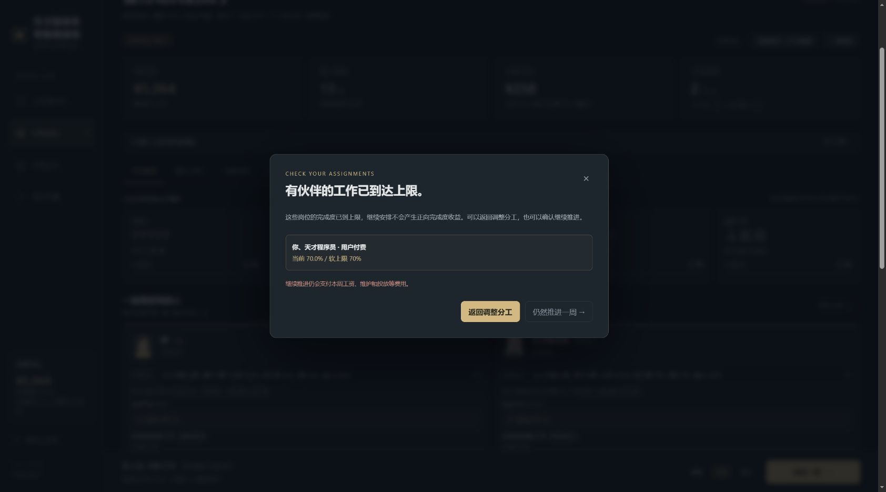

v0.9.2 首次加入创业补助时新增 12 组检查，当时全部规则检查共 135 组；以下为该版本历史验证记录（v0.9.5 已改为所有项目结束后才可领取）。覆盖门槛边界、空余额恢复立项、重复领取、活动项目与暂停恢复、账目与利润隔离、历史结算、成长保留及只读预览。浏览器实际验证 ¥4,806 + ¥2,794 = ¥7,600，立项表单保留名称/目标/真实模式、成功启动下一作、恢复原项目仍为第 4 周且累计投入 ¥774，刷新与 320px 页面宽度正常。记录见 `tests/startup-aid-browser-verification.json`。

v0.9.3 新增 14 组市场与收益检查，全部规则检查共 149 组。覆盖 10,000 个分布样本、80 组预估/结算区间、四档倍率、极端遇冷/走热、随机压过品质差距、同运气时品质仍有效、买量亏损与发行分成、资金守恒、一次结算和存档恢复。

市场浏览器验证：四档规模卡显示自然收入 ×1/×3/×9/×27 与市场 ×0.10～10.00；真实模式通过 6 周完成上架，发售前显示新风险说明。D+ 作品基准自然收入 ¥847，实际抽取 ×2.71，取整后自然收入 ¥2,295，累计成本 ¥1,548、项目结余 ¥747、余额 ¥8,347；刷新后历史回看全部一致。320px 窄屏文档宽度 305px、发售弹框宽度约 270.67px，无横向溢出。记录见 `tests/market-browser-verification.json`。
